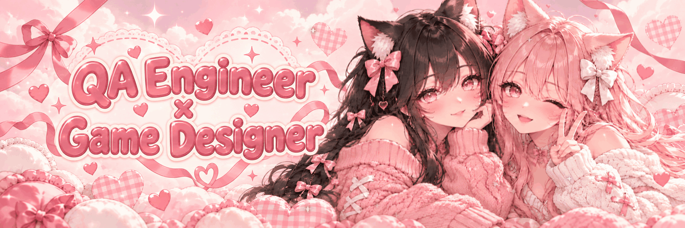

<h1>Sofia Stetsiuk =^･ω･^=</h1>

📍 Batumi, Georgia &nbsp;·&nbsp; 🌍 Remote / Hybrid / On-site / Relocation &nbsp;·&nbsp; 🎯 Open to **QA Engineer**, **Game QA** & **Game Design** roles

⋆｡ﾟ☁︎｡⋆｡ ﾟ☾ ﾟ｡⋆ &nbsp; =^･ω･^= &nbsp; ⋆｡ﾟ☁︎｡⋆｡ ﾟ☾ ﾟ｡⋆

## 🐾 About me

I test products the way players and users actually use them, design game systems for **Roblox**, and take web & game projects from idea to release — setting the tasks, making the design decisions and checking the results.

- 🧪 **QA Engineer** — Yandex Practicum graduate, hands-on manual testing of the *Multicart* browser extension
- 🎮 **Game Designer** — 4 released Roblox games: core loops, economy, balancing, co-op & multiplayer
- 🌐 **Web** — trilingual Next.js sites with Playwright tests and Lighthouse audits
- 🗣️ Russian (native) · English (B1)

⋆｡ﾟ☁︎｡⋆｡ ﾟ☾ ﾟ｡⋆ &nbsp; =^･ω･^= &nbsp; ⋆｡ﾟ☁︎｡⋆｡ ﾟ☾ ﾟ｡⋆

## 🌸 Featured projects

### 🌐 Web

| Project | What it is | Status |
|---|---|---|
| 🛍️ **[Grand Mall Batumi](https://grand-mall-three.vercel.app)** | Trilingual (EN/RU/KA) shopping-mall site: searchable store directory, interactive map, documented QA pass | ✅ Released |
| 🍷 **Sakhli** | One-page restaurant landing (KA/EN/RU) with a living pond animation, time-of-day hero, 100 Lighthouse accessibility | 🛠️ In development |
| 📚 **[IziEGE](https://claude.ai/artifact/7XccEcN3ejMwpetZetWbBy)** | ЕГЭ exam-prep app: 6 subjects, mock exams, AI-checked answers, flashcards, 60-sec blitz, weekly leaderboard | 🧩 Prototype |

### 🟥 Roblox

| Game | Genre | Play |
|---|---|---|
| 🪓 **Woodcutter vs Zombies** | Dark-fantasy tycoon — chop, upgrade, build a castle, survive nightly zombie waves | [▶ Play](https://www.roblox.com/games/126918896016438) |
| ✈️ **Cabin Chaos** | Cartoon co-op party game for 1–4 cabin crew | [▶ Play](https://www.roblox.com/games/122107110812286) |
| 🧱 **PILLARS: Hide & Stack** | Multiplayer hide-and-seek block game — hide, hunt, build the tallest pillar | [▶ Play](https://www.roblox.com/games/102854253424644) |
| 🐾 **Build Your Own Pet** | Build a pet from 6 parts with elements & rarities, earn parts in minigames, auto-PvP | [▶ Play](https://www.roblox.com/games/83887073812489) |

> 🎨 Plus a **3D showroom** of ~33 Blender models made for the Roblox Creator Store — see the [portfolio](https://sofia-stetsiuk-portfolio.vercel.app/en).

⋆｡ﾟ☁︎｡⋆｡ ﾟ☾ ﾟ｡⋆ &nbsp; =^･ω･^= &nbsp; ⋆｡ﾟ☁︎｡⋆｡ ﾟ☾ ﾟ｡⋆

## 🎀 Skills

<b>🧪 QA & Testing</b>

 

Manual functional testing · bug reports & defect reproduction · test scenarios & user journeys · regression & re-testing · responsive & accessibility testing · localization testing · game testing in Roblox Studio · Playwright automation · Lighthouse audits · basic SQL

<b>🎮 Game Design</b>

 

Core loops & progression · economy & monetization · balancing · multiplayer & co-op · level & map design · onboarding & retention · player UX & mobile UI

### ⚙️ Tech stack

 

⋆｡ﾟ☁︎｡⋆｡ ﾟ☾ ﾟ｡⋆ &nbsp; =^･ω･^= &nbsp; ⋆｡ﾟ☁︎｡⋆｡ ﾟ☾ ﾟ｡⋆

🐱 **Looking for a QA or game designer who actually plays?** → [Let's talk](https://t.me/silestiari)

